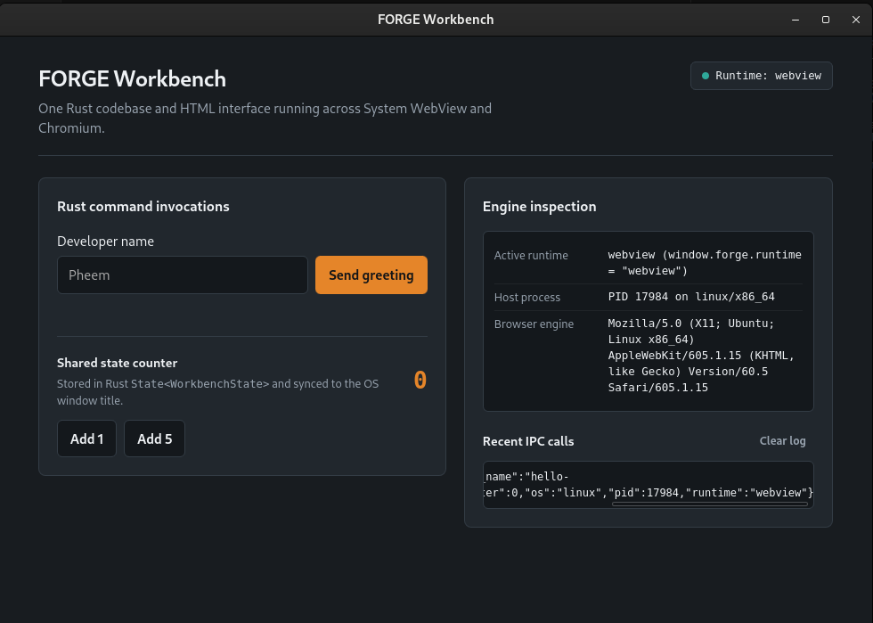

# FORGE

**Write once. Choose your runtime. Ship anywhere.**



---

## What is FORGE?

**FORGE** is a Rust-first desktop application platform and builder. It lets you build cross-platform desktop apps using **Rust** for application logic and **HTML/CSS/JS** (or **React + Vite**) for the UI—then switch between the lightweight **OS System WebView** (`WRY`) and **Chromium** (`CEF`) without changing a single line of application code.

---

## Why FORGE?

| | System WebView (`--runtime webview`) | Chromium (`--runtime cef`) |
| :--- | :--- | :--- |
| **Engine** | WebKitGTK / WebView2 / WKWebView | Embedded Chromium (CEF) |
| **Rendering** | Native OS WebView | Identical across Linux, Windows & macOS |
| **Bundle Size** | ~2–6 MB standalone / `.deb` | Self-contained Chromium bundle |
| **Code Changes** | None | None |

* **Zero Macros, Plain Rust:** Write standard `async fn` handlers with `State<T>` and `WindowHandle` extractors—fast compile times and full IDE autocomplete.
* **Built-in Security:** Same-Origin `forge://app/` protocol, random 256-bit per-launch `X-Forge-Token` CSRF protection, strict CSP, and symlink-safe asset/storage sandboxing.
* **Sub-5ms Automated Testing:** Test your entire app (`App::headless()`) in `cargo test` without opening a GUI window or display server.
* **Zero-Boilerplate Single Binary:** `forge build` embeds both `ui/` and `forge.toml` directly into your release executable automatically.

---

## What It Can Do

* **Dual Desktop Runtimes:** Switch between `webview` and `cef` via a single CLI flag (with automatic CEF binary caching).
* **Two-Way Rust ↔ Frontend Bridge:** Call Rust with `await window.forge.invoke(cmd, payload)` and push live events from Rust with `window.emit(...)` → `window.forge.listen(...)`.
* **Live Reload & Vite/React HMR:** Instant in-place CSS hot-swap, automatic HTML/JS reload, and built-in React + Vite + TypeScript scaffolding.
* **Application Bundler (`forge build`):** Package standalone executables, portable `.tar.gz` archives, and Debian/Ubuntu `.deb` installers with desktop icons.
* **Native Desktop Plugins (`forge::plugins`):** Ready-to-use File Dialogs, Clipboard, OS Notifications, and sandboxed App Storage.

---

## How to Use

### 1. Create a New Project

```bash
# Vanilla HTML/CSS/JS + Rust
cargo run -p forge-cli -- new my-app

# React + Vite + TypeScript + Rust
cargo run -p forge-cli -- new my-react-app --template react
```

### 2. Write Rust Commands & Call Them from JS

**`src/main.rs`**
```rust
use forge::{App, ForgeError};
use serde::{Deserialize, Serialize};

#[derive(Deserialize)]
struct GreetReq { name: String }

#[derive(Serialize)]
struct GreetRes { message: String }

async fn greet(req: GreetReq) -> Result<GreetRes, ForgeError> {
    Ok(GreetRes {
        message: format!("Hello, {}!", req.name),
    })
}

fn main() -> forge::Result<()> {
    App::new().command("greet", greet).run()
}
```

**`ui/main.js`**
```javascript
const res = await window.forge.invoke("greet", { name: "Pheem" });
console.log(res.message);
```

### 3. Run in Live Dev Mode

```bash
# Run on OS System WebView (with Hot Reload)
cargo run -p forge-cli -- dev --manifest-path examples/hello-forge/forge.toml --runtime webview

# Switch the exact same app to Chromium (CEF)
cargo run -p forge-cli -- dev --manifest-path examples/hello-forge/forge.toml --runtime cef
```

### 4. Build & Package for Distribution

```bash
cargo run -p forge-cli -- build --manifest-path examples/hello-forge/forge.toml --runtime webview
```

Outputs are generated in `dist/` (standalone executable, `.tar.gz`, and `.deb` installer).

---

## Documentation

* [Release Notes](RELEASE_NOTES.md)
* [Architecture Guide](docs/architecture.md)
* [Contributor & Agent Guide](AGENTS.md)
